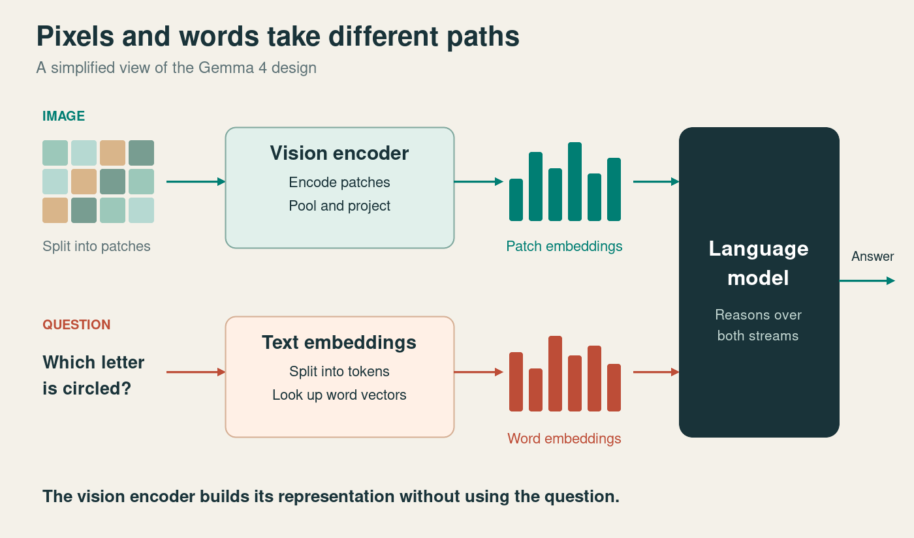
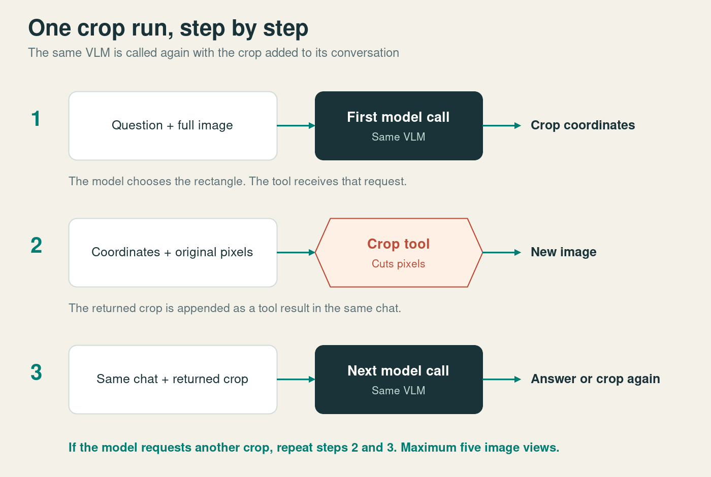
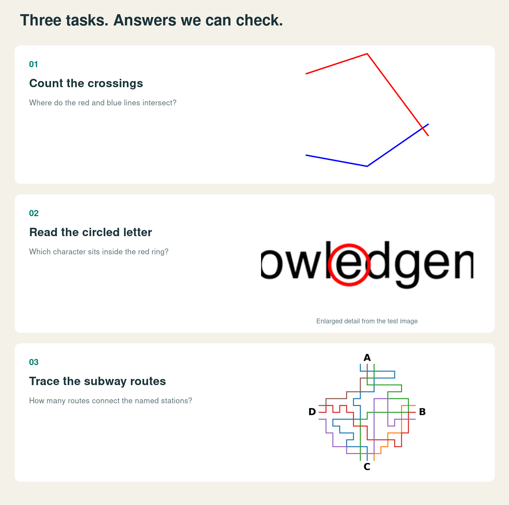
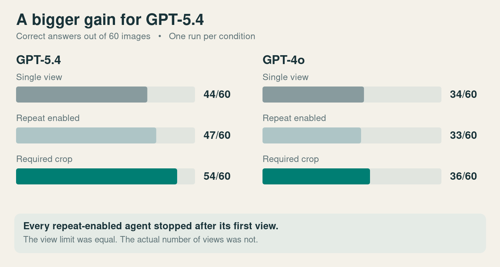
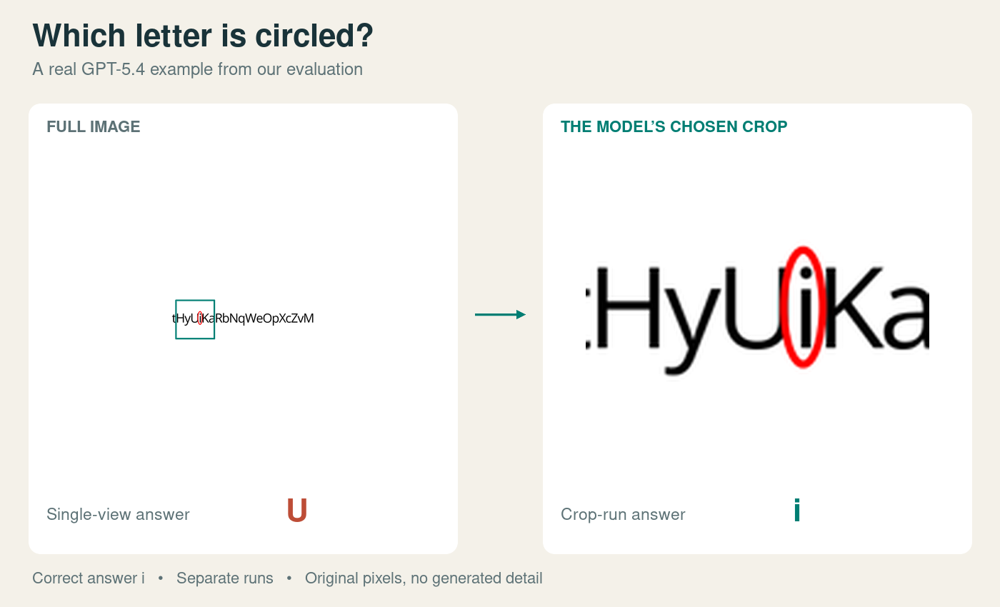
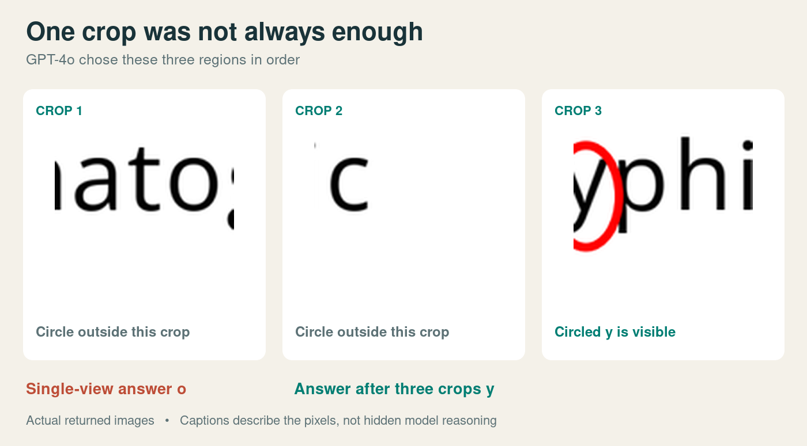

# Why VLMs are built wrong and why agentic VLMs are the solution

Give a vision language model a photo and it will describe the scene, read the signs, and explain the chart in the background. Then ask it how many times two lines cross, or which letter has a red circle around it, and it will confidently get it wrong. A child answers those at a glance.

I think a big part of the reason is a design decision. A VLM compresses the image into a fixed set of numbers before it has seen your question. It has to guess in advance which details will matter. When it guesses wrong, the detail you asked about is simply not there, and no amount of clever reasoning afterwards brings it back.

The proper fix is an encoder that knows the question, which means new architectures and retraining. But there is a fix that works on the models we already have. Let the model go back to the original pixels and look again, this time knowing what it is looking for. That is the agentic part. I tested the simplest version of it, a crop tool, on 60 benchmark images. GPT-5.4 went from 73% to 90%.

## What a VLM actually receives

A typical VLM is two models glued together, a vision encoder and a language model. The encoder cuts the image into patches and turns each patch into a vector, a list of numbers describing shapes, colours, and how neighbouring regions relate.

Your question takes a different path. A tokenizer splits the text into tokens, and each token is looked up in a table to get its own vector. Both sets of vectors then enter the language model, which reads them together and writes the answer.

The diagram is a simplified version of the [Gemma 4 architecture](https://newsletter.maartengrootendorst.com/p/a-visual-guide-to-gemma-4). A vision transformer encodes the patches, pooling merges neighbouring patches to save space, and a projection maps the result into the language model's embedding space.

The thing to notice is where the two paths meet. By the time the image and the question come together, the image has already been encoded. The encoder never sees the question. Typing the question before the image changes nothing, because the encoder runs on the image alone.

## What gets squeezed out

The encoder works with a fixed budget of vectors, and detail goes missing at every step. Resizing shrinks the image. Pooling merges small features into their neighbours. And the encoder itself learned during training which features are worth keeping and which are not.

That last one is the subtle one, so here is an example. In nearly every training photo with a sky in it, the sky is blue. The two go together so reliably that storing the colour separately is a waste of space. If you know it is sky, you already know the colour. A good compressor drops exactly this kind of redundancy.

Now show that model a photo with a green sky. The encoder can record that there is a sky and never record that it is green. Ask the language model what colour the sky is, and all it has to go on is its prior, which says blue.

This is only a thought experiment, but it shows the gap that matters. What is in the pixels and what reaches the language model are two different things.

## Thinking harder does not help

Once a detail is missing from the vectors, the language model cannot think its way back to it. It can reason for longer and you can ask again, but the same image through the same encoder gives the same vectors every time.

Text has a famous version of this problem. LLMs do not read letters. They read tokens, which are chunks of words. So you get this.

> **You** How many Rs are in strawberry?
>
> **What the model sees** `str` `aw` `berry`
>
> **Model** There are two Rs in strawberry.

The model is not bad at counting. It was asked to count letters and was never shown any. It is like handing you strawberry written in Chinese characters and asking how many Rs it has. Now change what the model gets to look at.

> **You** Spell strawberry one letter at a time, then count the Rs.
>
> **Model** S T R A W B E R R Y. There are three Rs.
>
> **What the model sees** `S` `T` `R` `A` `W` `B` `E` `R` `R` `Y`

Same model, same intelligence. The only thing that changed is that the things it had to count became visible.

This is what I mean by built wrong. Encoding the image once, without the question, is cheap and good enough for most questions. The price is paid on the questions that need exactly the detail the encoder did not bet on. Not every VLM mistake is of this kind, and some are plain reasoning errors. But this is the kind that more reasoning cannot fix. The model needs a better view.

## Let the model look again

A crop tool gives it one. The model looks at the full image, reads the question, and asks for a rectangle. Plain code cuts that rectangle out of the original pixels and hands it back. The same VLM then encodes the crop as a new image, in the same conversation.

The encoder is still compressing, but now it spends its whole budget on the region the question is about. A letter that covered two patches now covers fifty. The surroundings that were eating the budget are gone.

But how can the model know where to look for a detail it never saw? The same way you do. Picture a cat sitting small in a wide photo, and someone asks you to count its whiskers. You cannot make out a single whisker from there, but you know whiskers live on the face, so you zoom in on the face. Knowing where the information is takes far less than having it. The coarse first view is enough for that, and the original pixels hold the rest.

Cropping is just the simplest tool of this kind. An agent could also boost contrast, isolate one colour, or write its own image processing code. Anything that produces a new image to look at gives the encoder another chance, this time steered by the question.

## The experiment

I used three tasks from [VLMs Are Blind](https://vlmsareblind.github.io), a benchmark of visual questions that are trivial for people and surprisingly hard for models. Each one has a short answer that can be checked against ground truth.

- Count how many times a red line and a blue line cross
- Name the letter inside a red circle
- Count the subway routes connecting two named stations

I took 20 images per task, 60 in total, and ran GPT-5.4 and GPT-4o on every image in three setups.

- **Single view.** The model sees the full image once and answers.
- **Repeat.** The model may ask to see the full image again before answering.
- **Crop.** The model must crop at least once before answering, and may crop more.

In the two tool setups the model could look up to five times, counting the original. The model picks the crop coordinates itself and the tool cuts from the original image. The tool does nothing clever. It does not suggest a region, read text, or say whether an answer is right.

Why force the crop? Because in a pilot where cropping was optional, neither model ever used it. They do not seem to notice when their first view is not good enough. So the first crop is mandatory, which means this experiment tests whether a model can use a second look well, not whether it knows when to ask for one.

All the code is [on GitHub](https://github.com/DrejcPesjak/agentic-vlm-test).

## What happened

With cropping, GPT-5.4 went from **44/60 to 54/60** correct, which is **73% to 90%**. GPT-4o went from **34/60 to 36/60**, or **57% to 60%**.

For GPT-5.4 the crop was pure upside. It fixed ten answers and broke none. Most of the gain came from subway maps, which went from **6/20 to 14/20**. Circled letters went from **18/20 to 20/20**, and line intersections were already perfect.

Here is one of the fixed letters. Looking at the full image once, GPT-5.4 answered **U**. In the crop run it selected the region around the text and answered **i**, which is correct. The rectangle on the left is the region the model asked for.

GPT-4o is a different story. Cropping fixed nine of its wrong answers and broke seven that had been right. A second look only helps if the model aims it well and reads it well, and GPT-4o often does neither.

This run shows the aiming problem. GPT-4o's first two crops missed the red ring entirely. The third one caught the circled **y** and it answered correctly. With a single view it had answered **o**.

The repeat setup turned out to be a dud, but a useful one. Not once did either model take the offer to look at the full image again, so it is effectively a second single-view run. It scored **47/60** for GPT-5.4 and **33/60** for GPT-4o, which tells you how much these scores wobble from run to run. About three answers. GPT-4o's gain of two is inside that wobble. GPT-5.4's gain of ten is not.

## What this does and does not show

This is a small experiment. It covers 60 images, with one run per image and setup, 360 runs in total, for about **$2.06** of API usage. It shows that a capable model, told to look again, picks useful regions and answers better. It also shows that a weaker model gains almost nothing from the same tool.

It does not prove that the encoder dropped the missing details. They might still be somewhere in the vectors, just too buried for the language model to use. Telling those apart means opening up the representation itself. For practical purposes it hardly matters, because the remedy is the same either way. A new view, chosen with the question in mind.

So I still think VLMs are built wrong. The image gets compressed before anyone knows what it will be asked, and some questions pay for that. The real solution is an encoder guided by the question. Until someone ships that, an agent loop is the next best thing, and it works today. Let the model decide what to look at next, and give it the pixels.

*Images come from the [XAI VLMs Are Blind dataset](https://huggingface.co/datasets/XAI/vlmsareblind), by Rahmanzadehgervi, Bolton, Taesiri, and Nguyen. Code and setup are in the [repo](https://github.com/DrejcPesjak/agentic-vlm-test), and the full numbers are in the [evaluation notes](../evaluation-results.md).*
